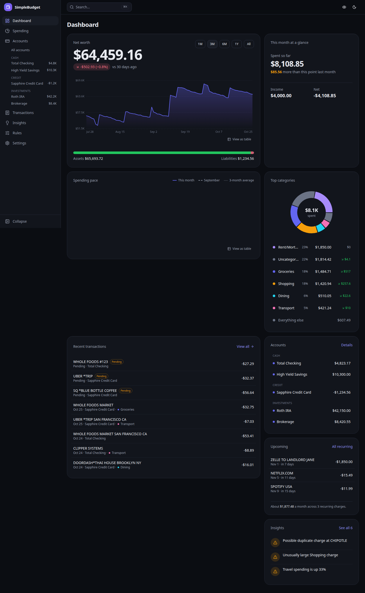
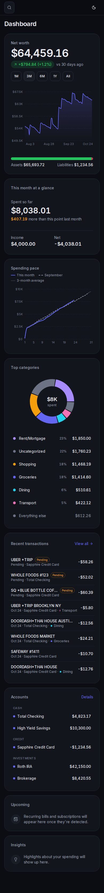
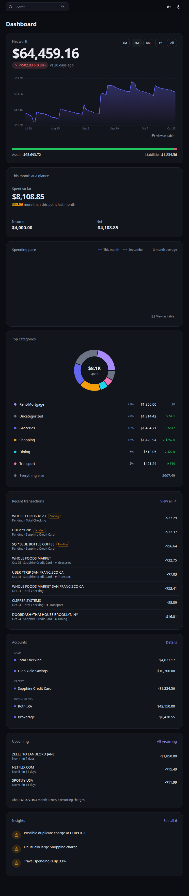

# SimpleBudget

A self-hosted personal finance dashboard for one person. It pulls your balances and transactions from your banks through
[SimpleFIN Bridge](https://beta-bridge.simplefin.org), stores everything in a single SQLite file on your own server, and
gives you a fast, mobile-friendly place to see where your money goes.



<p>
  
  
</p>

## Features

- **Accounts and net worth.** Every account with a running balance, a net-worth history chart and an assets-versus-liabilities split.
- **Transactions.** A fast, searchable register (10,000+ rows stay smooth) with filters, bulk edits, notes, tags, splits across categories and transfer detection.
- **Spending analytics.** Any month or custom range: category breakdown (donut or treemap), merchants, tags, accounts, a daily calendar, weekday pattern, 12-month trend and detected subscriptions. Almost every number drills down to the transactions behind it.
- **Categories and rules.** Rules categorize new imports automatically (by description, payee, amount, account or direction) and can be applied to history with a preview.
- **Targets.** Optional monthly limits per category or tag, with progress bars on the dashboard and Spending page.
- **Insights.** Plain-language findings worked out on your own server: unusual spending, price increases, duplicate charges, low balances, pace for the month and more.
- **Optional AI.** Off by default. Point it at any OpenAI-compatible server (OpenRouter, Open WebUI, Ollama, …) for a monthly summary and an "Ask about your spending" box. Only aggregated data is sent, never account numbers or your bank connection (see [Privacy](#privacy) and [`docs/AI.md`](docs/AI.md)).
- **Looking ahead.** A 30-day cash **forecast** from your recurring bills and paychecks, savings **goals** with progress rings and an on-track check, a **year in review**, and **holdings** for investment accounts when your institution reports them.
- **Manual accounts.** Track cash or anything not connected to a bank. Reconcile any account against a statement balance.
- **Import and export.** Import Actual Budget's CSV export (step-by-step guide: [`docs/MIGRATING-FROM-ACTUAL.md`](docs/MIGRATING-FROM-ACTUAL.md)) or any CSV with column mapping, export all transactions to CSV, and download a SQLite backup.
- **Alerts and currencies.** Optional push messages (ntfy or a webhook) for failed syncs and large transactions, and static exchange rates so accounts in other currencies add up to net worth in dollars.
- **Made to be used on a phone.** Installable as an app (PWA), bottom navigation, drawers instead of dialogs, and a **privacy mode** (the eye icon) that blurs every amount.
- **Desktop shortcuts.** `⌘K` command menu, `g` then `d`/`t`/`a`/`s`/`i`/`r` to jump around, `/` to search, `j`/`k` to move through the register, `c` to categorize. Press `?` for the list.
- **Looks after itself.** A nightly backup (the newest 14 are kept), structured logs with secrets redacted, security headers and CSRF protection.

## Quick start (Docker)

You need Docker with Compose, and a SimpleFIN account (see [Getting a SimpleFIN token](#getting-a-simplefin-token)).

```bash
git clone https://github.com/<you>/SimpleBudget.git
cd SimpleBudget

# 1. A long random secret. It encrypts your bank connection and signs your session, so keep it safe.
echo "APP_SECRET=$(openssl rand -hex 32)" > .env
echo "TZ=America/New_York" >> .env        # your time zone, so "this month" starts on your midnight

# 2. Start it
docker compose up -d --build
```

Open <http://localhost:3000> (set `HOST_PORT` in `.env` to use another port). The setup wizard asks you to create a password,
paste your SimpleFIN setup token, choose how much history to import and confirm your accounts.

Your data lives in `./data` (the SQLite database and the `backups` folder). Back that folder up, and keep `APP_SECRET`
somewhere separate: **without the same `APP_SECRET`, a restored database can't decrypt its bank connection.**

### Configuration

| Variable        | Required | Default                    | What it does                                                                          |
| --------------- | -------- | -------------------------- | ------------------------------------------------------------------------------------- |
| `APP_SECRET`    | yes      |                            | At least 32 characters. Encrypts stored secrets and signs session cookies.            |
| `TZ`            | no       | `UTC`                      | Your time zone (IANA name). Decides which day and month a transaction belongs to.     |
| `DATABASE_PATH` | no       | `/data/simplebudget.db`    | Where the SQLite file is (set for you in Docker).                                     |
| `BACKUP_DIR`    | no       | `<database folder>/backups`| Where nightly backups are written.                                                    |
| `COOKIE_SECURE` | no       | `false`                    | Set to `true` when you serve the app over HTTPS: marks the cookie Secure and sends HSTS. |
| `LOG_LEVEL`     | no       | `info`                     | `trace`, `debug`, `info`, `warn`, `error` or `silent`.                                |
| `HOST_PORT`     | no       | `3000`                     | Docker Compose only: the port published on your machine.                              |

## Putting it on the internet (reverse proxy)

SimpleBudget has a single-user password, but your finances deserve HTTPS. With [Caddy](https://caddyserver.com) the whole
config is:

```caddyfile
budget.example.com {
    reverse_proxy simplebudget:3000
}
```

Caddy gets and renews the certificate for you. Then set `COOKIE_SECURE=true` in `.env` and restart. If you use another
proxy, make sure it passes the original `Host` (or `X-Forwarded-Host`) header: the CSRF check compares it with the
browser's `Origin`. Better still, keep the app on a private network (Tailscale, WireGuard) and not on the public
internet at all.

## Getting a SimpleFIN token

1. Create an account at [SimpleFIN Bridge](https://beta-bridge.simplefin.org) and connect your banks there.
2. Choose **Create a SimpleFIN token** (or "New app connection") and copy the setup token it shows.
3. Paste it into SimpleBudget's setup wizard (or **Settings → Connections** later). The token is exchanged once for an
   access URL, which is stored encrypted.

SimpleFIN allows about 24 requests a day per connection; SimpleBudget stays within 20 and tells you how many an import or
sync will use.

## Backup and restore

- **Automatic:** a backup is written every night at 03:30 (server time zone) to `data/backups/simplebudget-YYYYMMDD-HHMMSS.sqlite`; the newest 14 are kept.
  **Settings → About** shows the latest ones and has a **Back up now** button.
- **Download:** **Settings → Export** has a CSV of every transaction and a one-click SQLite download.
- **Restore:** stop the app (`docker compose down`), copy the backup over `data/simplebudget.db` (delete `simplebudget.db-wal` and `-shm` next to it), start again.
  You need the same `APP_SECRET` that the backup was made with.

Backups contain your encrypted bank connection and password hash. Treat them like a password file.

## Privacy

Everything stays on your server. The only outbound connections are to SimpleFIN Bridge when you sync and, **only if you turn it on
under Settings → AI**, to the AI provider you choose. When AI is on, it receives category totals, merchant totals,
month-over-month changes and the insights shown on your Insights page. Account numbers, your SimpleFIN access URL, raw bank
descriptions, notes and balances are never sent unless you tick the box that shares account names and balances. When you ask
a question, the assistant can also look up at most 50 matching transactions (date, payee, amount, category). The API key is
stored encrypted and is never shown again.

## Development

```bash
pnpm install
cp .env.example .env.local   # or just: export APP_SECRET=$(openssl rand -hex 32)
pnpm dev                     # http://localhost:3000
pnpm db:seed-fake --setup    # a demo database with ~10,000 fake transactions (password: password1234)

pnpm lint && pnpm typecheck && pnpm test   # checks and unit tests
pnpm build && pnpm test:e2e                # Playwright end-to-end tests (needs a production build)
```

Notable choices are written down in [`DECISIONS.md`](DECISIONS.md); the full developer guide is [`docs/DEVELOPMENT.md`](docs/DEVELOPMENT.md). The stack is Next.js (App Router), TypeScript, SQLite
with Drizzle, Tailwind and shadcn/ui, TanStack Query, and Recharts. Money is always integer cents, formatted only through
`<Money>` / `formatCents`.

## Documentation
See [`docs/README.md`](docs/README.md) for the index: architecture, API, development, operations, AI setup and the Actual migration guide. AI agents and new contributors should start with [`AGENTS.md`](AGENTS.md).

## License

[GNU General Public License v3.0](LICENSE)
